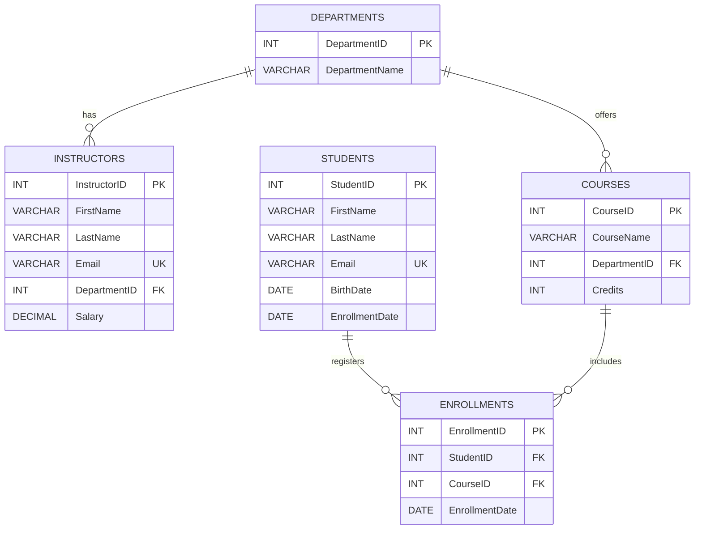
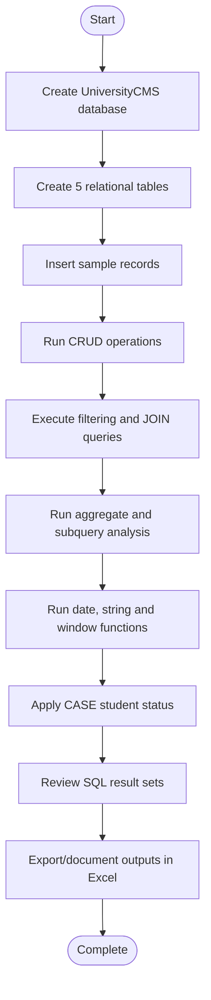
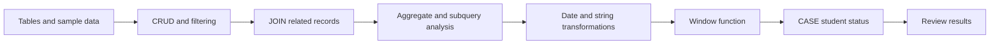

# University CMS — MySQL Database Project

A MySQL database project for managing university departments, instructors, courses, students, and enrollments. The SQL script demonstrates table creation, sample data insertion, CRUD operations, filtering, joins, aggregate functions, subqueries, date functions, string functions, window functions, and conditional logic.

## Table of Contents
- [Project Overview](#project-overview)
- [Objectives](#objectives)
- [Database Schema](#database-schema)
- [Workflow Flowchart](#workflow-flowchart)
- [Query Coverage](#query-coverage)
- [Requirements](#requirements)
- [How to Run](#how-to-run)
- [Output Workbook](#output-workbook)
- [Important Notes](#important-notes)
- [Project Structure](#project-structure)

## Project Overview

**Database:** `UniversityCMS`  
**SQL file:** `university_db.sql`  
**Output workbook:** `University_CMS_SQL_Outputs.xlsx`

The project includes five tables:

- `Departments` — department identifiers and names.
- `Instructors` — instructor details, email, department, and salary.
- `Courses` — course names, department, and credit values.
- `Students` — student contact details, birth date, and enrollment date.
- `Enrollments` — mapping between students and courses, including enrollment date.

## Objectives

- Create a relational university database using primary and foreign keys.
- Insert sample data into all five tables.
- Demonstrate Create, Read, Update, and Delete (CRUD) operations.
- Filter students by enrollment date and courses by department.
- Use `COUNT`, `AVG`, and `MAX` for analysis.
- Retrieve related data using `INNER JOIN` and `LEFT JOIN`.
- Apply subqueries, date/string functions, window functions, and `CASE`.

## Database Schema



## Workflow Flowchart



## Query Coverage

| Section | SQL concepts |
|---|---|
| Database setup | `CREATE DATABASE`, `USE`, `CREATE TABLE` |
| Constraints | Primary keys, unique email fields, foreign keys, `ON DELETE`, `ON UPDATE` |
| Sample data | `INSERT INTO` |
| CRUD | `INSERT`, `SELECT`, `UPDATE`, `DELETE` |
| Filtering | `WHERE`, enrollment date condition |
| Course lookup | `JOIN`, department filter, `LIMIT` |
| Aggregation | `COUNT`, `GROUP BY`, `HAVING`, `AVG`, `MAX` |
| Multi-course searches | `IN`, `GROUP BY`, `HAVING COUNT(DISTINCT ...)` |
| Joins | `INNER JOIN`, `LEFT JOIN` |
| Subquery | Courses with more than 10 enrollment records |
| Date function | `YEAR`, `DATEDIFF`, `CURRENT_DATE` |
| String function | `CONCAT` |
| Window function | `COUNT() OVER (ORDER BY ...)` |
| Conditional logic | `CASE` to label students as Senior or Junior |

## Query Processing Flowchart



## Requirements

- MySQL 8.0 or a compatible MySQL server.
- MySQL Workbench, MySQL Shell, or another MySQL client.
- The provided `university_db.sql` file.
- Microsoft Excel or a compatible spreadsheet application to view the output workbook.

## How to Run

1. Open your MySQL client and connect to the server.
2. Open `university_db.sql`.
3. Execute the script from top to bottom.
4. Check that the `UniversityCMS` database and five tables are created.
5. Review the result grids produced by the queries.

The script uses `CREATE DATABASE IF NOT EXISTS`, but its tables and sample inserts are not all guarded against repeated execution. Running it again against an already-populated database can cause duplicate table or primary-key errors. Use a fresh database or reset the tables before rerunning.

## Output Workbook

`University_CMS_SQL_Outputs.xlsx` contains formatted sheets for:

- Project overview and notes.
- The five source tables.
- CRUD operation summary.
- Each of the remaining query results, including empty result sets where the sample data does not meet a query's threshold.

**Important:** The workbook contains expected/static output based on the sample records in the SQL file; it is not an Excel connection to a live MySQL database. The student-status query uses `2026-10-18` as the reference date because the SQL itself uses `CURRENT_DATE`, so results can change on later execution dates.

## Important Notes

- The course-count query with `HAVING COUNT(e.StudentID) > 5` returns no rows for the supplied data.
- The subquery looking for courses with more than 10 enrollments also returns no rows for the supplied data.
- The query asking for students enrolled in both `Introduction to SQL` and `Data Structures` returns John Doe, because he has enrollment records for both courses.
- The SQL script's CRUD example inserts, reads, updates, and then deletes a temporary student record.

## Project Structure

```text
University-CMS-SQL/
├── university_db.sql
├── University_CMS_SQL_Outputs.xlsx
└── README.md
```

---


## 🎥 Project Explanation Video

[Click Here to Watch Video](https://drive.google.com/file/d/1zLL4FoUSaGtVi_pF6qJIGDF1I9TmmLm5/view?usp=sharing)

[Click Here to Watch Video](https://drive.google.com/file/d/1gZEi6ISoknK6Tw4SjEPu7bfHh-46PLdu/view?usp=sharing)
   
**Author:** Armin Khareghat

**Project type:** SQL Database Management  

**Database engine:** MySQL  

**Domain:** University Course and Enrollment Management
